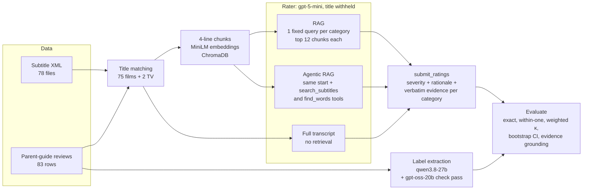
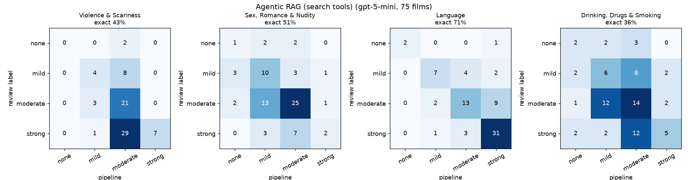

# Agentic RAG for age-appropriateness ratings from film subtitles

Can an LLM estimate how a parent guide would rate a film (violence, sex, language, drinking and drugs) from the subtitles alone? This repo answers that with three retrieval set-ups, scores every rating against parent-guide reviews of the same 75 films, and reports the numbers with confidence intervals, a majority-class baseline and a check on how reliable the labels themselves are.

**Result (75 films, gpt-5-mini):** the rater matches the review's severity level exactly 48–52% of the time and within one level 92% of the time, pooled over four categories. That is only slightly above always predicting the most common label (47% exact), but chance-corrected agreement is clearly higher (quadratic-weighted κ 0.41–0.46 against 0.17). Dialogue works well for language (up to 71% exact, κ 0.64) and poorly for violence and drinking, which depend more on what is shown than on what is said. The three set-ups fall inside each other's 95% intervals, and the agent used its search tools on only 17 of the 75 films. The whole three-mode run cost $1.07 at list price.

## The problem

Parent guides describe each film in a few categories ("Brutal boxing matches with graphic injuries", "Some strong language"). Writing them takes a person watching the whole film. Subtitles are cheap and available for almost everything, so the question is how far dialogue alone gets you, and whether letting the model search the transcript itself (agentic RAG) beats a fixed retrieval step or simply reading the whole transcript.

Each film is rated in four categories on one four-level rubric (`none`, `mild`, `moderate`, `strong`) defined in [`subrating/config.py`](subrating/config.py):

| Category | Review column |
|---|---|
| `violence` | Violence & Scariness |
| `sex` | Sex, Romance & Nudity |
| `language` | Language |
| `substances` | Drinking, Drugs & Smoking |

The same rubric is used to turn the reviews into labels and to prompt the rater, so both sides are scored on the same scale.

## Data

- **Subtitles:** 78 English subtitle files in tokenised XML (the OpenSubtitles corpus format) in `Modelling_Dataset/Subtitles_XML/`.
- **Reviews:** 83 parent-guide reviews across 10 genre CSVs in `Evaluation_Data/CS_Movie_Reviews/`, with a free-text field per category plus a "Parents Need to Know" summary.
- **Matching:** titles are normalised to slugs and matched exactly (71), then by whole-word prefix or suffix for scraped titles cut at a colon (6). 77 of the 78 subtitle files match a review: 75 films and 2 TV-series episodes. Only *Spartan* has no review. The table is in [`data/matched_films.csv`](data/matched_films.csv); the 2 TV episodes are indexed but left out of the evaluation.
- **Index:** each transcript is split into 4-line chunks and embedded with all-MiniLM-L6-v2 into a local ChromaDB store (25,274 chunks for the 77 titles).

## Approach



**Labels.** An LLM reads only the review text (never subtitles or rater output) and maps each category to the rubric through a strict `submit_labels` tool call, quoting the words that decided it ([`subrating/labels.py`](subrating/labels.py)). The labeler (`qwen/qwen3.8-27b` on Groq) is from a different model family than the rater, and a second, independent labeler (`openai/gpt-oss-20b`) measures how noisy the labels are.

**Rater.** Three modes, all answering through the same strict `submit_ratings` schema ([`subrating/rater.py`](subrating/rater.py)):

- **`rag`**: one dialogue-like query per category (for example "I'm going to kill you. Gun, shoot, blood…"), the top 12 chunks for each, one call.
- **`agentic`**: the same starting excerpts plus two tools. `search_subtitles` runs a new semantic search and returns only chunks the model has not seen; `find_words` counts exact words across the whole film (for profanity, drug or weapon names). The model decides what to look up, within 8 searches, then submits.
- **`full`**: the whole transcript in one call, as a long-context baseline (a median of about 10k input tokens per film).

Film titles are never sent to the rater, so ratings come from the dialogue rather than from what the model remembers about a famous film. Every rating carries up to three verbatim evidence lines per category, which the evaluation checks against the actual subtitles.

**Evaluation** ([`subrating/evaluate.py`](subrating/evaluate.py)). Every method is scored on the same films. Metrics: exact agreement, agreement within one level, quadratic-weighted Cohen's κ, a 95% bootstrap interval over films (2,000 resamples) for pooled exact agreement, the share of quoted evidence that really occurs in the subtitles, and a majority-label baseline per category. The baseline peeks at the label distribution, so it is an optimistic floor.

## Results

`gpt-5-mini` with reasoning effort `medium`, every mode on the same 75 films. The full tables are in [`results/metrics.md`](results/metrics.md), and every per-film rating (with its evidence lines and tool calls) is in [`results/ratings/gpt-5-mini/`](results/ratings/gpt-5-mini/).

| Method | Exact | 95% CI | Within one level | Weighted κ | Evidence found in subtitles | Mean tool calls | Cost (75 films) |
|---|---|---|---|---|---|---|---|
| Full transcript (no retrieval) | **52%** | 46%–58% | 92% | 0.46 | 95% of 745 | 0.0 | $0.43 |
| RAG, fixed query per category | **48%** | 42%–54% | 92% | 0.41 | 98% of 809 | 0.0 | $0.30 |
| Agentic RAG (search tools) | **50%** | 44%–56% | 92% | 0.44 | 98% of 785 | 0.4 | $0.34 |
| Majority label per category | 47% | — | 86% | 0.17 | — | — | — |

Exact agreement by category. Brackets show weighted κ, or for the baseline the label it always predicts:

| Category | Majority baseline | Full transcript | RAG | Agentic RAG |
|---|---|---|---|---|
| Violence & Scariness | 49% (strong) | 52% (κ 0.43) | 36% (κ 0.26) | 43% (κ 0.28) |
| Sex, Romance & Nudity | 55% (moderate) | 56% (κ 0.37) | 48% (κ 0.22) | 51% (κ 0.33) |
| Language | 47% (strong) | 60% (κ 0.49) | 68% (κ 0.65) | 71% (κ 0.64) |
| Drinking, Drugs & Smoking | 39% (moderate) | 40% (κ 0.33) | 39% (κ 0.26) | 36% (κ 0.25) |



Confusion matrices for the other modes: [full transcript](results/confusion_full.png), [RAG](results/confusion_rag.png).

**What the numbers say**

- **Language is the one category dialogue captures well.** RAG and agentic RAG reach 68–71% exact (κ 0.64–0.65). The full-transcript rater does worse here (60%) because it over-rates: it calls 16 of the 24 films the review rates "moderate" strong. 14 of those 16 contain at least one f-word, which makes language "strong" under the rubric.
- **Violence is mostly visual.** Reviews rate 37 of the 75 films "strong" for violence. The RAG rater calls 32 of those 37 "moderate"; reading the whole transcript recovers 17 of the 37. In every mode the mean signed error is negative for violence, sex and substances: dialogue under-reports what is shown.
- **The agent rarely searched.** It made 30 tool calls across 17 films (21 `find_words`, 9 `search_subtitles`) and submitted straight from the starting excerpts for the other 58. That makes agentic RAG cheap (about 5 cents more than plain RAG for all 75 films), and it scored 2 points higher, but that gap is well inside the intervals.
- **No mode is clearly best.** Full transcript leads on violence and sex and costs the most (median about 10k input tokens per film). With 75 films the 95% intervals of all three modes overlap, so this data cannot separate them.
- **Evidence is grounded.** 95–98% of the quoted evidence lines appear in the film's subtitles (after normalising case and punctuation), so almost all cited evidence is real dialogue.

## Label reliability

The labels are extracted by an LLM from short review text, so they are noisy, and the second labeler measures by how much. `openai/gpt-oss-20b`, labelling the same 75 reviews independently, agreed with the main `qwen/qwen3.8-27b` labels on 74% of the 300 film-category pairs (within one level: 99%, weighted κ 0.82). For scale, the best rater mode reaches 52% exact against the same labels.

| Category | none | mild | moderate | strong | from an empty review field |
|---|---|---|---|---|---|
| Violence & Scariness | 2 | 12 | 24 | 37 | 2 |
| Sex, Romance & Nudity | 5 | 17 | 41 | 12 | 6 |
| Language | 3 | 13 | 24 | 35 | 3 |
| Drinking, Drugs & Smoking | 7 | 18 | 29 | 21 | 7 |

The set leans heavily to "moderate" and "strong": most of these are films for teens and adults. When a review leaves a category empty and its summary does not mention it, the label is "none".

## Limitations

- **Subtitles only.** Gore, nudity and on-screen drinking are invisible to the rater, which shows in the negative signed error for violence, sex and substances. Dialogue-light films give it little to work with: the whole-transcript prompt for *The Passion of the Christ* is about 1.7k tokens, system prompt included.
- **LLM-extracted labels, not human annotation.** The reviews give a sentence or two per category, and two labelers disagree on 26% of pairs, which caps how well any rater can score.
- **Titles are withheld, but films may still be recognisable** from character names or famous lines. This repo does not measure how much that helps.
- **Small N.** 75 films (300 film-category pairs), mostly English-language releases from the late 1990s and 2000s, give intervals of about ±6 points, too wide to rank the three modes.
- **One rater, one run.** All numbers come from a single run of `gpt-5-mini` at medium effort; run-to-run variance and other models are not measured.
- **The majority baseline is optimistic.** It is chosen from the label distribution it is scored on.

## Demo app

[`app.py`](app.py) is a Streamlit app that runs the rater with **your own API key**:

- Pick a provider (Groq, OpenAI, Together AI or OpenRouter) and a model, and paste a key. The key is passed to that one run and is not stored, logged, cached or read from the server's environment.
- Rate one of the 75 films, or upload a subtitle file (`.srt` or OpenSubtitles `.xml`, up to 5 MB). Uploads are embedded in memory under a random id and deleted after the run.
- Watch the agent's tool calls as they happen, then read each category's rating, rationale and quoted evidence. Dataset films also show the parent-guide label.
- Without a key you can still browse the saved gpt-5-mini ratings for every film and method.

Groq's free tier works, but it allows about 8K tokens a minute, so an agentic run can pause between steps and the full-transcript mode is usually too large for it.

```bash
.venv/bin/streamlit run app.py
```

For local development only, `SUBRATING_DEV_ENV_KEYS=1` lets the app fall back to the keys in your `.env` when the key field is empty. Never set it on a public deployment.

**Deploying on Streamlit Community Cloud:** create an app from this repository with `app.py` as the main file and Python 3.11. `requirements.txt` already includes Streamlit. Add no secrets: visitors bring their own keys. On first use the server downloads the small embedding model Chroma uses (all-MiniLM-L6-v2).

## How to run

Python 3.10+.

```bash
python -m venv .venv && .venv/bin/pip install -r requirements.txt
```

The committed results can be re-scored without any API key:

```bash
.venv/bin/python -m subrating evaluate --model gpt-5-mini
```

To reproduce the pipeline end to end, copy `.env.example` to `.env` and add a key for the provider you use (OpenAI, Groq, Together AI or OpenRouter). Every `label` and `rate` run skips finished films, so a run stopped by a rate limit resumes when you rerun it.

```bash
.venv/bin/python -m subrating match                  # subtitles -> reviews, writes data/matched_films.csv
.venv/bin/python -m subrating index                  # embeds chunks into .cache/chroma (~5 min)
.venv/bin/python -m subrating label --workers 4      # review labels (Groq, qwen3.8-27b)
.venv/bin/python -m subrating label --check --workers 4
.venv/bin/python -m subrating estimate --provider openai --model gpt-5-mini   # cost estimate, no API calls
.venv/bin/python -m subrating rate --provider openai --model gpt-5-mini --effort medium --mode agentic --workers 8
.venv/bin/python -m subrating evaluate --model gpt-5-mini
```

Try the retrieval on one film without an API key:

```bash
.venv/bin/python -m subrating search layer_cake "put the gun down"
.venv/bin/python -m subrating search layer_cake fuck,shit,damn --words
```

Tests (no API key; the first run downloads the small embedding model Chroma uses):

```bash
.venv/bin/python -m pytest -q
```

## Repository layout

```text
subrating/
  subtitles.py   parse OpenSubtitles XML and .srt files, chunk lines
  reviews.py     load review CSVs, match titles to subtitle files
  index.py       ChromaDB store, semantic search, exact word counts
  llm.py         one OpenAI-compatible client for OpenAI, Groq, Together AI, OpenRouter; usage and cost
  rater.py       prompts, tools and the rag / agentic / full rating loop
  labels.py      review text -> rubric labels
  evaluate.py    agreement metrics, bootstrap CI, evidence grounding, baseline
  report.py      results/metrics.md, metrics.json and confusion matrices
  __main__.py    CLI: match, index, search, estimate, rate, label, evaluate
  demo.py        helpers for the demo app: key handling, uploads, saved ratings
app.py           Streamlit demo (bring your own key)
tests/           unit tests with fake LLM backends
data/            matched_films.csv
results/         labels, per-film ratings (JSON with evidence and tool calls), metrics
Modelling_Dataset/, Evaluation_Data/   raw subtitles and reviews
notebooks/colab_prototype.ipynb, docs/RAG_presentation.pptx   the original prototype
```
