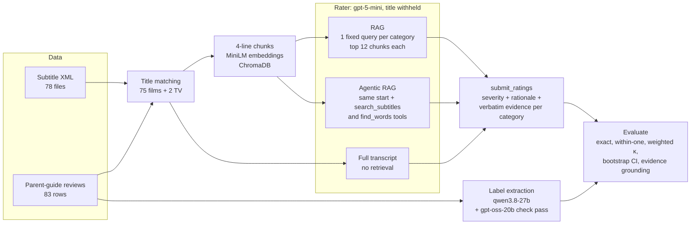
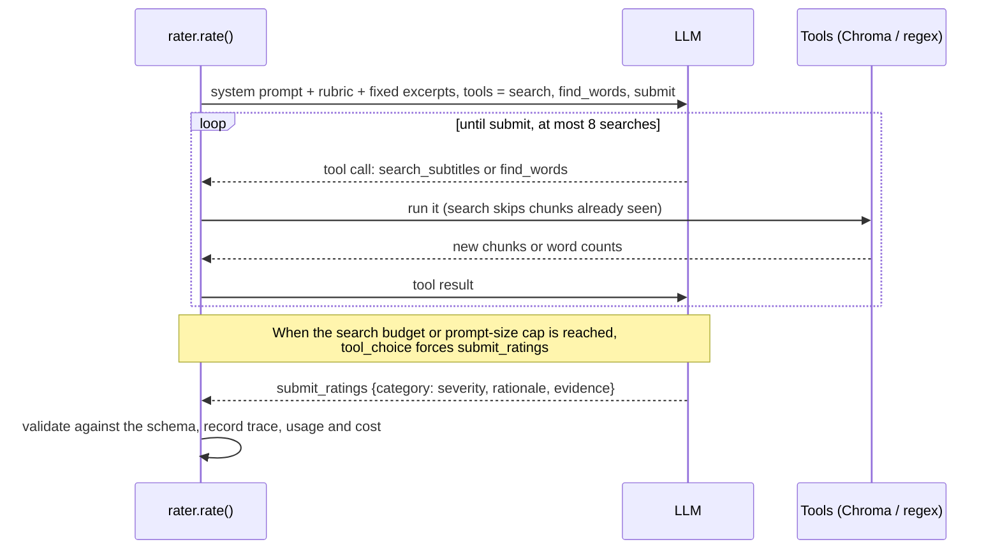

# Agentic RAG for age-appropriateness ratings from film subtitles

**Can an AI read a film's subtitles and tell parents how violent, sexual, profane or drug-heavy the film is?** This project builds that system three different ways, tests it on 75 real films against published parent-guide reviews, and reports how often it gets the answer right, what it costs, and where it fails.

**In one sentence:** on 75 films, the AI matches the parent guide's rating exactly about half the time and is within one step of it 9 times in 10, for under half a cent per film. It is good at judging language and weak at judging violence and drinking, because those are mostly seen on screen rather than heard.

---

## Start here: pick your path

This README is written for three kinds of reader. Read the short version, then follow your path. Each section stands on its own.

| If you are… | You probably want to know… | Read these sections |
|---|---|---|
| **A business or non-technical reader** | What it does, how well, what it costs, what the risks are | [The short version](#the-short-version) → [Business overview](#business-overview-no-code) → [Glossary](#glossary-plain-english) |
| **New to the code (intern, student, career changer)** | What the ideas mean, how to run it, where to start reading | [The short version](#the-short-version) → [Key ideas in five minutes](#key-ideas-in-five-minutes) → [Your first hour](#your-first-hour) → [Code tour](#code-tour) → [Troubleshooting](#troubleshooting) |
| **A senior engineer or reviewer** | Architecture, evaluation rigour, trade-offs, what is not proven | [How it works](#how-it-works) → [Results in full](#results-in-full) → [Design decisions and trade-offs](#design-decisions-and-trade-offs) → [Threats to validity](#threats-to-validity) → [Reproducibility](#reproducibility) |

---

## The short version

### What it does

1. You give it a film's **subtitles**: the text of everything said in the film.
2. An AI model (a **large language model**, or LLM) reads the relevant parts and rates four categories on a four-step scale: **none, mild, moderate, strong**.
3. For every rating it writes a short reason and **quotes the exact subtitle lines** it relied on, so a person can check its work.

| Category | What it covers |
|---|---|
| Violence & Scariness | fights, weapons, deaths, gore, horror |
| Sex, Romance & Nudity | kissing, innuendo, sex scenes, nudity |
| Language | insults, swearing, the f-word, slurs |
| Drinking, Drugs & Smoking | alcohol, cigarettes, drug use or dealing |

The film's **title is hidden from the AI**, so it has to judge from the dialogue instead of recalling what it already knows about a famous film.

### How well it works (75 films)

| What we measured | Result | In plain words |
|---|---|---|
| Exact match with the parent guide | **48–52%** depending on method | about half of all ratings are exactly right |
| Within one step (e.g. "moderate" vs "strong") | **92%** | 9 in 10 ratings are right or one step off |
| Best category: Language | **up to 71%** exact | swearing is in the dialogue, so it is easy to judge |
| Hardest categories: Violence, Drinking | **36–52%** exact | these are mostly visual, and subtitles don't show them |
| Quotes that really exist in the subtitles | **95–98%** | the AI almost never invents evidence |
| Cost per film (gpt-5-mini) | **$0.004–$0.006** | under half a cent |
| Time per film | **about 22–24 seconds** (median) | many films can run at once |

For comparison, always guessing the most common rating in each category would be exactly right 47% of the time. So the AI is only slightly better at *exact* matches. Where it clearly beats guessing is in getting the *order* right (which films are worse than others) and in staying close: see [weighted kappa](#glossary-plain-english).

### One film, end to end

*Broken Flowers*, agentic mode, gpt-5-mini. It took 24 seconds and cost $0.0036.

| Category | AI rating | Parent-guide label | Match |
|---|---|---|---|
| Violence & Scariness | moderate | moderate | ✓ |
| Sex, Romance & Nudity | moderate | moderate | ✓ |
| Language | strong | strong | ✓ |
| Drinking, Drugs & Smoking | moderate | strong | ✗ (one step milder) |

For drinking and drugs, the AI quoted *"It's just cannabis sativa."* and judged that the dialogue shows drug references but not heavy use, so it said "moderate". The parent guide said "strong", probably because of what is shown on screen. This miss is typical of the system: it under-rates what it cannot see.

---

## Business overview (no code)

### The problem

Parent guides and age ratings are written by people who watch the whole film and take notes. That is slow and expensive, and large back catalogues (older films, international titles, user uploads) often have no detailed guide at all. Subtitles, on the other hand, exist for almost every film and cost almost nothing to process.

This project asks a practical question: **how much of a parent guide can you produce automatically from subtitles alone, how reliably, and at what cost?**

### Who might use something like this

These are possible uses, not products that exist:

- **Streaming catalogues:** draft content notes for titles that have none, for a human editor to approve.
- **Parental-control apps:** a first-pass signal ("strong language likely") where no human rating exists.
- **Content operations teams:** sort a large back catalogue so reviewers look at the riskiest titles first.
- **Localisation and compliance:** flag dialogue that may need attention in a new market.

### How it works, without code

Think of a research assistant with three different ways of working:

1. **Fixed search (RAG).** The assistant runs one standard search per category over the script ("guns, blood, fight…" for violence), reads the top passages and gives a rating.
2. **Agent (agentic RAG).** Same start, but the assistant can **run its own follow-up searches** when the first results look thin. For example: "count every time a swear word appears in the whole film". Then it decides.
3. **Read everything (full transcript).** The assistant reads the entire script in one go and decides.

In every case the assistant must fill in the same form: a rating, a reason and up to three exact quotes per category. Separately, a *different* AI reads the human-written parent-guide reviews and turns them into the same four ratings, so the two can be compared fairly.

### Results in plain words

- **About half of the ratings are exactly right; 9 in 10 are right or one step off.**
- **Language works well** (up to 7 in 10 exactly right), because swearing is spoken.
- **Violence and drinking work poorly** (between 36% and 52% exactly right), because blood, injuries and on-screen drinking are seen, not heard. The AI tends to rate these **milder** than the parent guide.
- **The three approaches perform about the same.** Reading the full script is a little better on violence and costs a little more, and the agent is a little better than fixed search. On 75 films none of these differences is large enough to be sure it is real.
- **The agent rarely chose to search.** It ran extra searches on only 17 of the 75 films and was happy with the standard excerpts for the rest.
- **The evidence is real.** 95–98% of quoted lines appear in the actual subtitles, so a reviewer can check any rating in seconds.

### Cost and speed

| Approach | Cost per film | Cost for all 75 films | Median time per film |
|---|---|---|---|
| Fixed search (RAG) | $0.0040 | $0.30 | 22 s |
| Agent | $0.0046 | $0.34 | 24 s |
| Read everything | $0.0057 | $0.43 | 22 s |

These are list prices for OpenAI's `gpt-5-mini` model. At the agent's average cost, 10,000 films would come to about $46 (simple arithmetic, ignoring retries and price changes). Films are processed in parallel (8 at a time in these runs), so throughput is limited mostly by the provider's rate limits. The project also runs on **free** open-source models through Groq's free tier, more slowly.

### What it is good for, and what it is not

| Good for | Not good for |
|---|---|
| A first draft that a person reviews | Replacing human ratings or official age classifications |
| Judging language and spoken references | Judging anything visual: gore, nudity, on-screen drinking |
| Triage: finding which titles need a closer look | High-stakes decisions without a human in the loop |
| Explaining itself with quotes anyone can check | Films with little dialogue (silent stretches, foreign-language films with sparse English subtitles) |

### Risks and responsible use

- **It errs on the mild side for visual content.** Used unsupervised, it would under-warn parents about violence. Treat its output as a draft.
- **The "correct answers" are themselves approximate.** They were extracted by an AI from short review text. Two different AIs extracting them agreed 74% of the time, so some "errors" are disagreements about the label, not mistakes by the rater.
- **Small test set.** 75 films is enough to see patterns, not to guarantee performance on every genre or era.
- **Privacy in the demo app.** Visitors use their own API key. It is used for one run and never stored or logged. Uploaded subtitle files are deleted after the run.

### Try it

A [demo app](#demo-app) lets anyone pick a film (or upload subtitles), paste their own API key and watch the AI work step by step. Without a key, the app still shows the saved results for every film. It is not hosted publicly yet; the [demo app](#demo-app) section explains how to run or deploy it.

---

## Key ideas in five minutes

If any term below is new, this section explains it using the project as the example. A shorter [glossary](#glossary-plain-english) is at the end.

**Subtitles as data.** Each film comes as an XML file in which every sentence has an id, a start time and its words. [`subrating/subtitles.py`](subrating/subtitles.py) turns that into clean lines such as `[00:00:49] I've got it.` Uploaded `.srt` files are parsed into the same shape.

**Large language model (LLM).** A model that reads text and writes text. Here it reads subtitle passages and writes ratings. We call it through an API (a web service), which charges per **token**, roughly ¾ of an English word.

**Embeddings and a vector database.** To search by *meaning* rather than exact words, each chunk of 4 consecutive subtitle lines is turned into a list of numbers (an **embedding**) by a small model, all-MiniLM-L6-v2. Chunks with similar meaning get similar numbers. The embeddings are stored in **ChromaDB**, a vector database, so a query like "put the gun down" finds chunks about armed threats even if they never use those words.

**RAG (retrieval-augmented generation).** Instead of sending the whole film to the LLM, you **retrieve** the most relevant chunks first and send only those. That is cheaper and keeps the model focused. Here the retrieval uses one fixed query per category and takes the top 12 chunks for each.

**Agent and tool calling.** An **agent** is an LLM that can decide to call functions you give it before answering. This project gives it two **tools**:

- `search_subtitles(category, query)`: a new meaning-based search that returns only chunks it hasn't seen yet.
- `find_words(words)`: exact counts of words across the whole film, which is useful for profanity.

The model calls a tool, our code runs it and sends back the result, and the model either searches again or submits its answer.

**Structured output.** The model must answer by calling a `submit_ratings` tool whose arguments follow a strict JSON schema: for each category, a `severity` (one of the four levels), a `rationale` and an `evidence` list. That makes the output machine-readable and the same on every provider.

**Labels and evaluation.** To know whether a rating is right we need a reference answer, called a **label**. The labels come from parent-guide reviews: a different LLM reads each review's text and maps it onto the same four-level scale. Then we count how often the rater and the label agree.

**Agreement metrics.**

- *Exact agreement:* same level.
- *Within one:* at most one level apart.
- *Weighted kappa (κ):* agreement corrected for luck, where bigger misses cost more. 0 means no better than chance and 1 means perfect.
- *Bootstrap confidence interval:* we resample the films many times to see how much the score would wobble with a different sample of 75 films.

---

## How it works

### Architecture



### Data

- **Subtitles:** 78 English subtitle files in tokenised XML (the OpenSubtitles corpus format) in `Modelling_Dataset/Subtitles_XML/`. The films have 128 to 3,505 subtitle lines each (median 1,278).
- **Reviews:** 83 parent-guide reviews across 10 genre CSVs in `Evaluation_Data/CS_Movie_Reviews/`. Each has a free-text field per category plus a "Parents Need to Know" summary.
- **Matching** ([`subrating/reviews.py`](subrating/reviews.py)): scraped review titles are messy (trailing spaces, "(2005)", " TV Review", titles cut at a colon). Both sides are normalised to slugs and matched exactly (71 files), then by whole-word prefix or suffix (6 files). 77 of the 78 subtitle files match a review: 75 films and 2 TV-series episodes. Only *Spartan* has no review. The result is [`data/matched_films.csv`](data/matched_films.csv). The 2 TV episodes are indexed but left out of the evaluation.
- **Index** ([`subrating/index.py`](subrating/index.py)): 4-line chunks embedded with all-MiniLM-L6-v2 (Chroma's default ONNX embedder) into a local ChromaDB store at `.cache/chroma`. That is 25,274 chunks for the 77 titles, built in about 5 minutes on a laptop.

### The rater

All three modes share one system prompt containing the rubric, which is defined once in [`subrating/config.py`](subrating/config.py) and used for labels too. The prompt tells the model to infer on-screen content only where dialogue supports it, to rate the most intense content found, to quote up to 3 lines verbatim, and not to try to identify the film.

| Mode | What the model sees | LLM calls per film | Median input tokens |
|---|---|---|---|
| `rag` | 4 × top-12 chunks from one fixed, dialogue-like query per category | 1 | 2,570 |
| `agentic` | the same excerpts, plus `search_subtitles` and `find_words`, up to 8 searches | 1.31 on average | 2,943 |
| `full` | the entire transcript | 1 | 9,466 |

The agent loop ([`subrating/rater.py`](subrating/rater.py)):



Details that matter:

- Every tool call is recorded in the rating file with its input and a summary of its output, so each agentic rating has an audit trail.
- If a model answers in plain text instead of calling the tool, valid JSON in the text is accepted; otherwise the model is asked again.
- Invalid ratings (an unknown severity, say) are sent back as a tool error and the model retries, within a 12-turn cap.
- `max_prompt_tokens` stops further searches once the conversation would exceed a provider's limit. Groq's free tier rejects requests above 8K tokens per minute, so its default is 6,500; other providers have no cap. The env var `MAX_PROMPT_TOKENS` overrides it.

**A real trace** (*Spawn*, agentic). The agent made one call to count profanity and substances across the whole film:

```json
{"tool": "find_words",
 "input": {"words": ["fuck", "shit", "bitch", "hell", "damn", "crap", "drunk", "smoke", "cigarette", "beer", "wine", "drug"]},
 "counts": {"fuck": 0, "shit": 1, "bitch": 2, "hell": 25, "damn": 7, "crap": 4, "drunk": 0, "smoke": 0, "cigarette": 0, "beer": 0, "wine": 0, "drug": 0}}
```

With no f-words anywhere in the film, it rated language "moderate", matching the review label. Plain RAG also said "moderate"; the full-transcript rater said "strong".

### Labels

[`subrating/labels.py`](subrating/labels.py) sends only the review text (never subtitles or rater output) to an LLM. The LLM must call `submit_labels` with, per category, a `severity`, the review words that decided it (`basis`), and where they came from (`category_field`, `summary` or `empty_field`).

- The main labeler, `qwen/qwen3.8-27b` on Groq, is from a different model family than the rater, so no model grades its own habits.
- A second labeler, `openai/gpt-oss-20b`, labels the same reviews independently to measure label noise.

### Evaluation

[`subrating/evaluate.py`](subrating/evaluate.py) scores every mode on the **same set of films** (those with labels and with ratings from every mode), so the rows are directly comparable.

- **Exact** and **within-one** agreement, per category and pooled over the four categories (300 film-category pairs).
- **Quadratic-weighted Cohen's κ** on the 4×4 confusion matrix $O$, with the expected matrix $E$ built from its marginals:

  $$\kappa_w = 1 - \frac{\sum_{ij} w_{ij} O_{ij}}{\sum_{ij} w_{ij} E_{ij}}, \qquad w_{ij} = \frac{(i-j)^2}{(K-1)^2}, \quad K = 4$$

- **95% bootstrap CI** for pooled exact agreement: 2,000 resamples of *films* (not pairs) with replacement, seed 0. Films are the unit because a film's four categories are correlated.
- **Evidence grounding:** the share of quoted evidence lines that appear in the film's subtitles after lower-casing and collapsing punctuation (a hallucination check).
- **Majority baseline:** predicts each category's most common label for every film. It peeks at the label distribution, so it is an optimistic floor.
- **Mean signed error** per category: the average of prediction minus label, in levels. Negative means the rater is milder than the review.

[`subrating/report.py`](subrating/report.py) writes `results/metrics.json`, `results/metrics.md` and one confusion-matrix figure per mode.

---

## Results in full

`gpt-5-mini` with reasoning effort `medium`, every mode on the same 75 films. Source: [`results/metrics.md`](results/metrics.md). Every per-film rating (severities, rationales, evidence, tool calls, tokens, cost, latency) is in [`results/ratings/gpt-5-mini/`](results/ratings/gpt-5-mini/).

### Overall (4 categories pooled, 300 pairs per row)

| Method | Exact | 95% CI | Within one level | Weighted κ | Evidence found in subtitles | Mean tool calls | Cost (75 films) |
|---|---|---|---|---|---|---|---|
| Full transcript (no retrieval) | **52%** | 46%–58% | 92% | 0.46 | 95% of 745 | 0.0 | $0.43 |
| RAG, fixed query per category | **48%** | 42%–54% | 92% | 0.41 | 98% of 809 | 0.0 | $0.30 |
| Agentic RAG (search tools) | **50%** | 44%–56% | 92% | 0.44 | 98% of 785 | 0.4 | $0.34 |
| Majority label per category | 47% | — | 86% | 0.17 | — | — | — |

### By category

Exact agreement. Brackets show weighted κ, or for the baseline the label it always predicts.

| Category | Majority baseline | Full transcript | RAG | Agentic RAG |
|---|---|---|---|---|
| Violence & Scariness | 49% (strong) | 52% (κ 0.43) | 36% (κ 0.26) | 43% (κ 0.28) |
| Sex, Romance & Nudity | 55% (moderate) | 56% (κ 0.37) | 48% (κ 0.22) | 51% (κ 0.33) |
| Language | 47% (strong) | 60% (κ 0.49) | 68% (κ 0.65) | 71% (κ 0.64) |
| Drinking, Drugs & Smoking | 39% (moderate) | 40% (κ 0.33) | 39% (κ 0.26) | 36% (κ 0.25) |

Mean signed error (prediction minus label, in levels; negative is milder than the review):

| Category | Full transcript | RAG | Agentic RAG |
|---|---|---|---|
| Violence & Scariness | -0.12 | -0.33 | -0.29 |
| Sex, Romance & Nudity | -0.16 | -0.24 | -0.28 |
| Language | +0.39 | +0.13 | +0.17 |
| Drinking, Drugs & Smoking | -0.19 | -0.21 | -0.21 |


Confusion matrices for the other modes: [full transcript](results/confusion_full.png), [RAG](results/confusion_rag.png).

### Latency and cost per film

| Mode | Median seconds | 90th percentile | Max | Mean cost | Median output tokens |
|---|---|---|---|---|---|
| RAG | 21.8 | 37.4 | 53.6 | $0.0040 | 1,578 |
| Agentic RAG | 24.4 | 46.0 | 176.2 | $0.0046 | 1,686 |
| Full transcript | 22.4 | 34.0 | 64.3 | $0.0057 | 1,489 |

Reading the whole transcript is not slower even though its input is almost four times larger. Output (mostly reasoning) tokens are similar across modes and track latency more closely than input size does.

### What the numbers say

- **Language is the one category dialogue captures well.** RAG and agentic RAG reach 68–71% exact (κ 0.64–0.65). The full-transcript rater does worse here (60%) because it over-rates. It calls 16 of the 24 films the review rates "moderate" strong; 14 of those 16 contain at least one f-word, which makes language "strong" under the rubric.
- **Violence is mostly visual.** Reviews rate 37 of the 75 films "strong" for violence. The RAG rater calls 32 of those 37 "moderate"; reading the whole transcript recovers 17 of the 37. In every mode the mean signed error is negative for violence, sex and substances: dialogue under-reports what is shown.
- **The agent rarely searched, and searching was not clearly helpful.** It made 30 tool calls (21 `find_words`, 9 `search_subtitles`) across 17 films and submitted straight from the starting excerpts for the other 58. On those 17 films, 13 category ratings differ from plain RAG: 6 moved onto the review's label, 6 moved off it, and 1 moved closer without matching. Part of that is ordinary run-to-run variation, since the two modes also differ in prompt.
- **No mode is clearly best.** The 95% intervals of all three modes overlap, so 75 films cannot separate them.
- **Per film,** the agentic rater got all 4 categories right on 8 films, 3 on 13, 2 on 30, 1 on 19 and none on 5.
- **Evidence is grounded.** 95–98% of quoted lines appear in the film's subtitles, so almost all cited evidence is real dialogue.

### Label reliability

`openai/gpt-oss-20b`, labelling the same 75 reviews independently, agreed with the main `qwen/qwen3.8-27b` labels on **74%** of the 300 film-category pairs (within one level: 99%, weighted κ 0.82). For scale, the best rater mode reaches 52% exact against the same labels.

| Category | none | mild | moderate | strong | from an empty review field |
|---|---|---|---|---|---|
| Violence & Scariness | 2 | 12 | 24 | 37 | 2 |
| Sex, Romance & Nudity | 5 | 17 | 41 | 12 | 6 |
| Language | 3 | 13 | 24 | 35 | 3 |
| Drinking, Drugs & Smoking | 7 | 18 | 29 | 21 | 7 |

The set leans heavily towards "moderate" and "strong": most of these are films for teens and adults. When a review leaves a category empty and its summary does not mention it, the label is "none".

---

## Your first hour

A step-by-step path for someone new to the project. Nothing here needs an API key until step 6.

**1. Prerequisites.** Python 3.10 or newer, and git. Check with `python3 --version`.

**2. Get the code and install it.**

```bash
git clone https://github.com/innovatewithfaizan/Agentic-Retrieval-Augmented-Generation-for-AI-Powered-Content-Moderation.git
```

```bash
cd Agentic-Retrieval-Augmented-Generation-for-AI-Powered-Content-Moderation
```

```bash
python3 -m venv .venv && .venv/bin/pip install -r requirements.txt
```

**3. Run the tests.** You should see `38 passed`. The first run downloads the small embedding model Chroma uses, so it needs internet once.

```bash
.venv/bin/python -m pytest -q
```

**4. Re-score the committed results.** This rebuilds `results/metrics.md` from the saved ratings without calling any AI, and prints the tables shown above.

```bash
.venv/bin/python -m subrating evaluate --model gpt-5-mini
```

**5. Explore one film.** Exact word counts need nothing extra. A meaning-based search embeds that film's subtitles first, which takes a few seconds.

```bash
.venv/bin/python -m subrating search layer_cake fuck,shit,damn --words
```

```bash
.venv/bin/python -m subrating search layer_cake "put the gun down"
```

Film ids are the first column of [`data/matched_films.csv`](data/matched_films.csv). Then open a rating file, for example `results/ratings/gpt-5-mini/agentic/spawn.json`, and compare it with that film's line in `results/review_labels.jsonl`.

**6. Rate a film yourself.** Get a free key from [Groq](https://console.groq.com/keys), copy `.env.example` to `.env` and put the key after `GROQ_API_KEY=`. Never commit `.env`; it is already in `.gitignore`.

```bash
.venv/bin/python -m subrating rate --mode agentic --films spawn
```

This uses the defaults (Groq, `openai/gpt-oss-120b`) and writes `results/ratings/openai_gpt-oss-120b/agentic/spawn.json`.

**7. Open the demo app** and click through a film:

```bash
.venv/bin/streamlit run app.py
```

**8. Read the code** in the order given in the [code tour](#code-tour).

### Running the whole pipeline

Every `label` and `rate` run skips films that are already done, so a run stopped by a rate limit resumes when you rerun it.

```bash
.venv/bin/python -m subrating match
.venv/bin/python -m subrating index
.venv/bin/python -m subrating label --workers 4
.venv/bin/python -m subrating label --check --workers 4
.venv/bin/python -m subrating estimate --provider openai --model gpt-5-mini
.venv/bin/python -m subrating rate --provider openai --model gpt-5-mini --effort medium --mode rag --workers 8
.venv/bin/python -m subrating rate --provider openai --model gpt-5-mini --effort medium --mode agentic --workers 8
.venv/bin/python -m subrating rate --provider openai --model gpt-5-mini --effort medium --mode full --workers 8
.venv/bin/python -m subrating evaluate --model gpt-5-mini
```

| Step | What it does | Writes |
|---|---|---|
| `match` | pairs subtitle files with reviews | `data/matched_films.csv` |
| `index` | embeds all chunks (about 5 minutes) | `.cache/chroma/` (gitignored) |
| `label` / `label --check` | review text → labels (Groq, free tier) | `results/review_labels.jsonl`, `results/review_labels_check.jsonl` |
| `estimate` | token and cost estimate, no API calls | prints only |
| `rate` | rates films in one mode | `results/ratings/<model>/<mode>/<film_id>.json` |
| `evaluate` | compares ratings with labels | `results/metrics.{json,md}`, `results/confusion_<mode>.png` |

---

## Code tour

About 1,700 lines of Python in the package and app, plus about 450 lines of tests. Suggested reading order:

| # | File | What it does | Look for |
|---|---|---|---|
| 1 | [`subrating/config.py`](subrating/config.py) | paths, the 4 categories, the rubric, fixed queries, retrieval settings | `RUBRIC`, `CATEGORY_QUERIES`, `TOP_K` |
| 2 | [`subrating/subtitles.py`](subrating/subtitles.py) | XML and SRT parsing, cleaning, chunking | `parse_xml`, `parse_srt`, `chunk_lines` |
| 3 | [`subrating/reviews.py`](subrating/reviews.py) | loads review CSVs, matches titles | `slugify`, `match_films` |
| 4 | [`subrating/index.py`](subrating/index.py) | ChromaDB store, semantic search, exact word counts | `Store.search`, `find_words`, `FilmContext` |
| 5 | [`subrating/llm.py`](subrating/llm.py) | one OpenAI-compatible client for 4 providers, prices, usage | `PROVIDERS`, `Backend.chat`, `Usage` |
| 6 | [`subrating/rater.py`](subrating/rater.py) | prompts, tool schemas and the rating loop | `SYSTEM`, `rate` |
| 7 | [`subrating/labels.py`](subrating/labels.py) | review text → labels | `label_review` |
| 8 | [`subrating/evaluate.py`](subrating/evaluate.py) | metrics, bootstrap, grounding, baseline | `weighted_kappa`, `run` |
| 9 | [`subrating/report.py`](subrating/report.py) | markdown tables and figures | `markdown` |
| 10 | [`subrating/__main__.py`](subrating/__main__.py) | the CLI, thread pool, resume and daily-limit handling | `run_all`, `cmd_rate` |
| 11 | [`subrating/demo.py`](subrating/demo.py), [`app.py`](app.py) | demo helpers (key handling, uploads) and the Streamlit UI | `resolve_key`, `upload_context` |
| 12 | [`tests/`](tests/) | unit tests with fake LLM backends, plus a Streamlit smoke test | `FakeBackend` in `test_rater.py` |

<details>
<summary><b>File formats</b></summary>

**`data/matched_films.csv`**: `film_id, subtitle_file, review_title, genre, kind (film|tv), match (exact|prefix|suffix)`.

**`results/review_labels.jsonl`**: one line per film:

```json
{"film_id": "...", "provider": "groq", "model": "qwen/qwen3.8-27b",
 "labels": {"violence": {"basis": "<words from the review>", "source": "category_field", "severity": "strong"}, "...": "..."},
 "usage": {"calls": 1, "input_tokens": 1353, "output_tokens": 166, "cost_usd": 0.00175}}
```

**`results/ratings/<model>/<mode>/<film_id>.json`**: one file per film:

```json
{"film_id": "broken_flowers", "mode": "agentic", "provider": "openai", "model": "gpt-5-mini", "effort": "medium",
 "ratings": {"substances": {"rationale": "...", "evidence": ["It's just cannabis sativa.", "..."], "severity": "moderate"}, "...": "..."},
 "tool_calls": [],
 "usage": {"calls": 1, "input_tokens": 3199, "output_tokens": 1386, "cost_usd": 0.00357},
 "seconds": 24.4}
```

Each `tool_calls` entry looks like the *Spawn* trace above: the tool name, its input, and counts or the number of new chunks.

</details>

<details>
<summary><b>CLI reference</b></summary>

`python -m subrating <command>`:

| Command | Arguments |
|---|---|
| `match` | none |
| `index` | none |
| `search FILM QUERY` | `-k N` (default 12), `--words` (QUERY becomes comma-separated words, exact counts) |
| `estimate` | film options below |
| `rate` | `--mode {rag,agentic,full}` (required), `--effort {low,medium,high}`, `--workers N`, film options |
| `label` | `--check` (second labeler), `--effort`, `--workers N`, film options |
| `evaluate` | `--model NAME` (whose ratings to score) |

Film options: `--provider {groq,openai,together,openrouter}`, `--model NAME`, `--films id1,id2`, `--limit N` (pilot run), `--include-tv`.

</details>

<details>
<summary><b>Configuration reference</b></summary>

Environment variables (put them in `.env`; see [`.env.example`](.env.example)):

| Variable | Default | Purpose |
|---|---|---|
| `GROQ_API_KEY`, `OPENAI_API_KEY`, `TOGETHER_API_KEY`, `OPENROUTER_API_KEY` | none | provider keys, read by the CLI only |
| `PROVIDER` | `groq` | default provider for the CLI |
| `RATER_MODEL` | `openai/gpt-oss-120b` | default rater model |
| `LABEL_MODEL` | `qwen/qwen3.8-27b` | main labeler |
| `CHECK_LABEL_MODEL` | `openai/gpt-oss-20b` | second labeler |
| `EFFORT` | `medium` | reasoning effort |
| `MAX_PROMPT_TOKENS` | provider default (6,500 on Groq, none elsewhere) | stop agent searches above this prompt size; `0` disables |
| `SUBRATING_DEV_ENV_KEYS` | unset | demo app only: `1` lets it use `.env` keys locally. Never set it on a public deployment. |

Constants in [`subrating/config.py`](subrating/config.py): `CHUNK_SIZE = 4` lines, `TOP_K = 12` chunks per category for RAG, `AGENT_SEARCH_K = 6` chunks per agent search, `AGENT_MAX_SEARCHES = 8`.

Providers and models offered (in [`subrating/llm.py`](subrating/llm.py)):

| Provider | Models | List price per million tokens (in / out) |
|---|---|---|
| Groq | `openai/gpt-oss-120b`, `openai/gpt-oss-20b`, `qwen/qwen3.8-27b` | $0.15 / $0.60, $0.075 / $0.30, $0.80 / $4.00 |
| OpenAI | `gpt-5-mini`, `gpt-5-nano`, `gpt-4.1-mini` | $0.25 / $2.00, $0.05 / $0.40, $0.40 / $1.60 |
| Together AI | `openai/gpt-oss-120b`, `Qwen/Qwen3.5-9B` | $0.15 / $0.60, $0.17 / $0.25 |
| OpenRouter | `openai/gpt-oss-120b`, `openai/gpt-oss-20b` | same as Groq for these models |

Prices were checked in October 2026 and are used only for reporting; the provider's bill is the source of truth.

</details>

### Common extensions

- **Add a provider:** add an entry to `PROVIDERS` in `llm.py` (base URL, env var name, models, key URL) and its prices to `PRICES`. If it needs special reasoning parameters, handle them in `Backend.extra_body`.
- **Add a category:** add it to `CATEGORIES`, `RUBRIC` and `CATEGORY_QUERIES` in `config.py`. The review CSVs must have a matching column for the labels.
- **Try a different retrieval setting:** change `CHUNK_SIZE` (then rebuild the index), `TOP_K` or the queries, rerun `rate` with a different model name or into a copy of the repo, then `evaluate`.

---

## Demo app

[`app.py`](app.py) is a Streamlit app that runs the rater with **the visitor's own API key**:

- Pick a provider (Groq, OpenAI, Together AI or OpenRouter), a model and an effort level, and paste a key.
- Rate one of the 75 films, or upload a subtitle file (`.srt` or OpenSubtitles `.xml`, up to 5 MB).
- Watch the agent's tool calls appear as they happen, then read each category's rating, rationale and quoted evidence. Dataset films also show the parent-guide label, with ✓ or ✗.
- Without a key you can still browse the saved gpt-5-mini ratings for every film and method.

```bash
.venv/bin/streamlit run app.py
```

How the key is protected:

- The CLI's backend falls back to environment keys when none is given. The app never allows that: [`demo.make_backend`](subrating/demo.py) refuses an empty key, and `demo.resolve_key` reads the environment only when `SUBRATING_DEV_ENV_KEYS=1` is set for local development.
- The key is used only for that run's client. It is not cached (no `st.cache_*` function takes it), logged or written anywhere, and provider error messages are redacted before display.
- Uploads are embedded in an in-memory store under a random id and deleted after the run.

Groq's free tier works, but it allows about 8K tokens a minute, so an agentic run can pause for a minute between steps and the full-transcript mode is usually too large for it.

**Deploying on Streamlit Community Cloud:** create an app from this repository with `app.py` as the main file and Python 3.11. `requirements.txt` already includes Streamlit. Add no secrets: visitors bring their own keys. On first use the server downloads the small embedding model Chroma uses.

---

## Design decisions and trade-offs

| Decision | Why | Trade-off or alternative |
|---|---|---|
| **Withhold the film title** from the rater | ratings should come from dialogue, not from what the model memorised about famous films | famous films can still be recognised from names and lines; not measured (see [threats](#threats-to-validity)) |
| **One rubric** for labels and rater, defined once in `config.py` | both sides are scored on exactly the same scale | the rubric's "one f-word makes language strong" rule is stricter than some reviews, which shows up as over-rating in full-transcript mode |
| **Labeler from a different model family** than the rater, plus an independent second labeler | no model grades its own habits, and label noise gets a number | LLM labels are still not human annotation |
| **Strict tool-call schema** (`strict: true`) for every answer | structured output that works the same on OpenAI, Groq, Together and OpenRouter; validation catches the rest | a text-JSON fallback is kept for models that ignore tools |
| **One OpenAI-compatible client** for all providers | one code path; provider quirks live in `Backend.extra_body` | features outside the chat-completions API are not used |
| **Agent starts from the RAG excerpts** | agentic RAG is a strict superset of RAG, so the comparison isolates the effect of tools | the model often judges the excerpts sufficient and never searches (58 of 75 films) |
| **Budgeted agent** (8 searches, seen-chunk exclusion, prompt-size cap, forced submit) | bounded cost and latency, no repeated passages, works within Groq's free-tier limits | can stop searching before a hard case is resolved |
| **`find_words` exact counts** next to semantic search | profanity and drug names are lexical; an embedding search is poor at "is there any f-word?" | simple stems plus common endings, not a full morphological analyser |
| **Same film set for every row**, film-level bootstrap | fair comparison; films are the independent unit, not category pairs | intervals are wide at N = 75 |
| **Evidence grounding check** | turns "does it hallucinate quotes?" into a number | normalised substring match, so a faithful paraphrase counts as a miss |
| **One JSON file per film**, skip-if-exists, stop on daily limit | runs are resumable and safe to interrupt; partial results are never lost | no locking across concurrent processes writing the same mode |
| **Results committed to git** | anyone can re-score without API keys; `evaluate` reproduces `metrics.md` byte for byte | about 13k lines of results in the repo |
| **Bring-your-own-key demo** | a public demo with no hosting bill and no shared secret | visitors need a key, and free tiers are slow |

### Engineering notes

- **Concurrency.** `run_all` uses a thread pool. ChromaDB client creation is not thread-safe, so `persistent_store()` creates it once under a lock, and `Store` wraps queries and inserts in its own lock. The Streamlit app shares one in-memory store per server process via `st.cache_resource`.
- **Failure handling.** The OpenAI SDK retries with backoff (6 retries, 120 s timeout). Per-film exceptions are reported and the run continues. A provider's daily-limit error stops new work cleanly so the run can resume later.
- **Cost tracking.** Every rating records calls, input and output tokens, and list-price cost. `estimate` gives a pre-run estimate from character counts without calling any API.
- **Testing.** 38 tests, with no API keys and no network beyond the one-time embedding-model download. LLM calls are replaced by `FakeBackend` objects that replay scripted tool calls, which exercises the agent loop, budget enforcement, validation retries and the prompt-size guard. Metrics are checked against hand computations. The Streamlit app has an `AppTest` smoke test that confirms nothing can be sent without a key.
- **Secrets.** `.env` and `.env.*` are gitignored (except `.env.example`). The CLI reads keys from the environment; the app only from the visitor.

---

## Threats to validity

What these results do **not** prove:

1. **Visual content is invisible.** Gore, nudity and on-screen drinking cannot be judged from dialogue. This is a hard ceiling for subtitles-only rating, and it shows as negative signed error for violence, sex and substances.
2. **Labels are LLM-extracted, not human annotation.** The reviews give a sentence or two per category, and two LLM labelers disagree on 26% of pairs. That caps the achievable score and makes small differences between modes hard to interpret.
3. **Memorisation.** Titles are withheld, but a model may recognise a famous film from character names or lines. This repo does not measure how much that helps.
4. **Small N.** 75 films (300 film-category pairs), mostly English-language releases from the late 1990s and 2000s, with labels skewed towards moderate and strong content. Intervals are about ±6 points.
5. **No paired test between modes.** Overlapping intervals are reported, not a paired significance test. A paired bootstrap of the difference would be the right next check.
6. **One rater, one run.** All numbers come from a single run of `gpt-5-mini` at medium effort. Run-to-run variance and other models are not measured.
7. **Optimistic baseline.** The majority baseline is chosen from the label distribution it is scored on.
8. **Dialogue-light films** give the rater little to work with: the whole-transcript prompt for *The Passion of the Christ* is about 1.7k tokens, system prompt included.

### What would improve it

In rough order of value for effort:

- A **human-labelled subset** (even 30 films) to measure how far LLM labels drift from people.
- **Repeat runs** and a **paired bootstrap** between modes, to separate method effects from noise.
- Prompting or a policy that **makes the agent search** on borderline categories, since it currently rarely does.
- **Calibrating the language rule** (for example by f-word count) against the reviews.
- **Keyframe vision** for the visual categories, which subtitles cannot cover.
- More raters (open and closed models) on the same film set.

---

## Reproducibility

- **Re-score without keys:** `python -m subrating evaluate --model gpt-5-mini` regenerates `results/metrics.{json,md}` and the figures from the committed ratings and labels. On a clean checkout the output is identical to the committed files.
- **Re-run the models:** follow [Running the whole pipeline](#running-the-whole-pipeline). LLM outputs are not deterministic, so a re-run will give slightly different numbers. The headline run used `gpt-5-mini`, effort `medium` and 8 workers, and cost $1.07 at list price for all three modes.
- **Versions:** pinned in [`requirements.txt`](requirements.txt) (ChromaDB 1.5.9, OpenAI SDK 3.35, Streamlit 1.66, NumPy, Matplotlib, pytest). Python 3.10+.

---

## Repository layout

```text
app.py           Streamlit demo (bring your own key)
subrating/
  config.py      paths, categories, rubric, queries, retrieval settings
  subtitles.py   parse OpenSubtitles XML and .srt files, chunk lines
  reviews.py     load review CSVs, match titles to subtitle files
  index.py       ChromaDB store, semantic search, exact word counts
  llm.py         one OpenAI-compatible client for OpenAI, Groq, Together AI, OpenRouter; usage and cost
  rater.py       prompts, tools and the rag / agentic / full rating loop
  labels.py      review text -> rubric labels
  evaluate.py    agreement metrics, bootstrap CI, evidence grounding, baseline
  report.py      results/metrics.md, metrics.json and confusion matrices
  demo.py        helpers for the demo app: key handling, uploads, saved ratings
  __main__.py    CLI: match, index, search, estimate, rate, label, evaluate
tests/           unit tests with fake LLM backends, plus a Streamlit smoke test
data/            matched_films.csv
results/         labels, per-film ratings (JSON with evidence and tool calls), metrics, figures
Modelling_Dataset/, Evaluation_Data/   raw subtitles and reviews
notebooks/colab_prototype.ipynb, docs/RAG_presentation.pptx   the original prototype
.streamlit/config.toml   upload size limit for the demo
```

---

## Troubleshooting

| Symptom | Cause | Fix |
|---|---|---|
| `No API key: set GROQ_API_KEY in .env or pass one in.` | no key for the chosen provider | add it to `.env`, or pass `--provider` for a provider whose key you have |
| `Daily limit reached at <film>; rerun the same command later to resume.` | the provider's daily quota (common on Groq's free tier) | wait and rerun the same command; finished films are skipped |
| A run seems stuck for a minute | per-minute rate limit; the SDK is waiting to retry | normal on free tiers; use `--workers 1` or a paid tier |
| `unknown film_id ...; see data/matched_films.csv` | a typo in the film id | copy the id from the first column of that file |
| The first test or search run is slow | Chroma downloads its embedding model once | wait; later runs use the cached model |
| Full-transcript mode fails on Groq | the transcript (about 10k tokens) is over the free tier's 8K tokens per minute | use RAG or agentic mode, or another provider |
| The demo app's button is greyed out | no key entered | paste a key in the sidebar, or browse the saved ratings without one |

---

## Glossary (plain English)

| Term | Meaning |
|---|---|
| **Subtitles** | the text of what is said in a film, with timestamps |
| **LLM (large language model)** | an AI that reads and writes text, like the models behind ChatGPT |
| **Token** | the unit LLMs read and charge by, roughly ¾ of a word |
| **Embedding** | a list of numbers that captures the meaning of a piece of text, so similar texts can be found |
| **Vector database (ChromaDB)** | a database that stores embeddings and quickly finds the most similar ones |
| **RAG (retrieval-augmented generation)** | look up the relevant passages first, then let the AI answer from them |
| **Agent / agentic** | an AI that can decide to use tools (here: searching the subtitles) before answering |
| **Tool call** | the AI asking the program to run a function and return the result |
| **Rubric** | the written definitions of none, mild, moderate and strong for each category |
| **Label** | the reference answer each rating is compared against, here taken from parent-guide reviews |
| **Exact agreement** | the share of ratings that match the label exactly |
| **Within one** | the share of ratings that are at most one level away from the label |
| **Weighted kappa (κ)** | agreement adjusted for luck, where big misses count more than small ones. 0 is chance and 1 is perfect; 0.41–0.60 is often described as moderate agreement and above 0.80 as almost perfect |
| **Confidence interval (95% CI)** | the range the score would likely fall in with a different sample of films |
| **Bootstrap** | estimating that range by re-sampling the films many times |
| **Majority baseline** | always guessing the most common answer; the score to beat |
| **Grounding / hallucination** | whether quoted evidence really exists in the source; a hallucination is an invented quote |
| **Reasoning effort** | how much the model "thinks" before answering (low, medium, high); more effort costs more |
| **BYOK (bring your own key)** | each user supplies their own API key instead of the app owner paying |

---

## Data and licence note

The subtitle files and parent-guide reviews are third-party data included for research and evaluation; check their original terms before reusing them. This repository does not yet include a licence file for the code.
